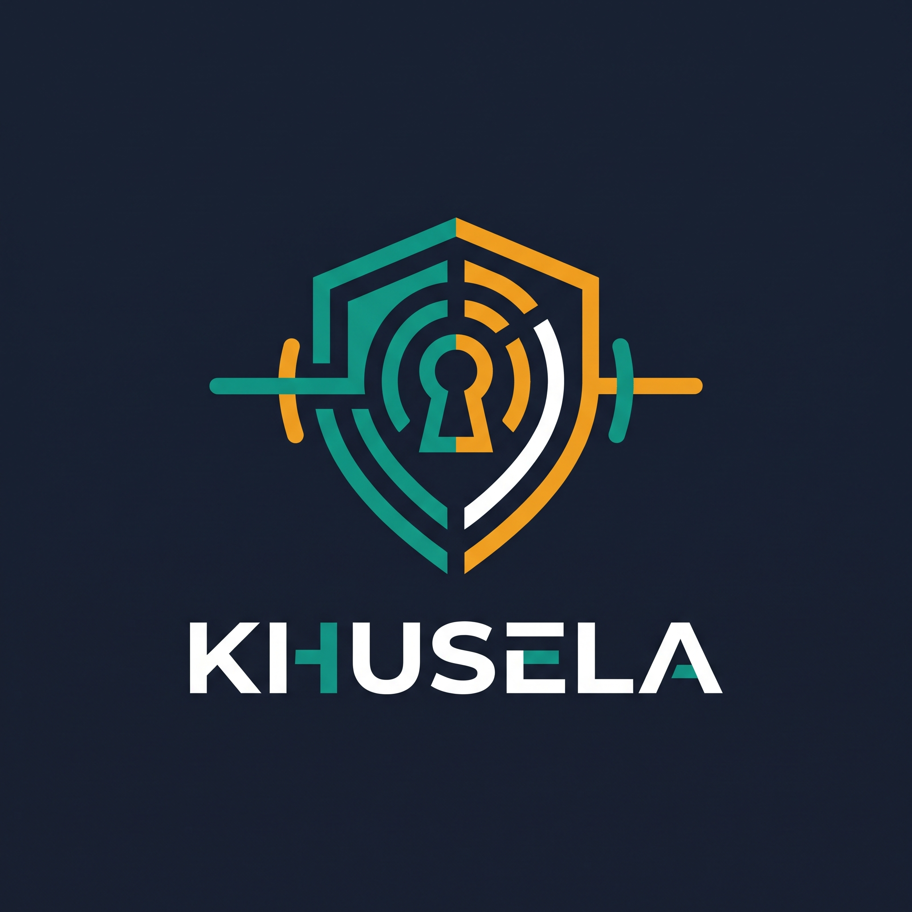
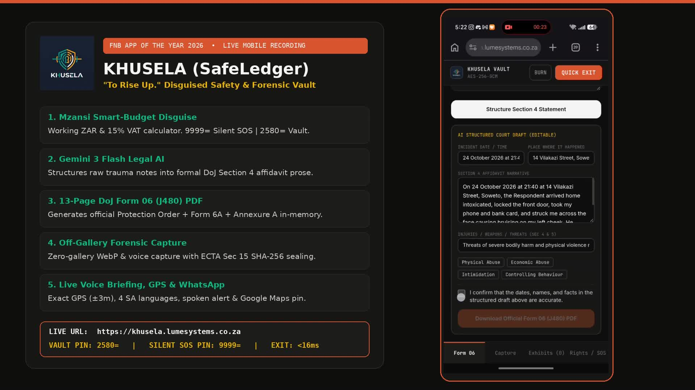
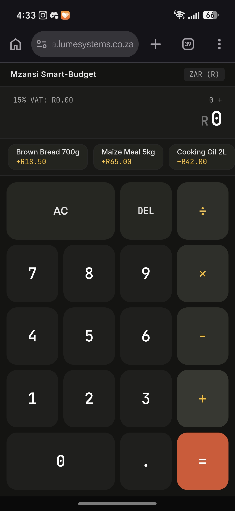
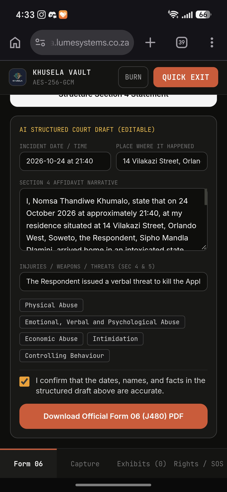
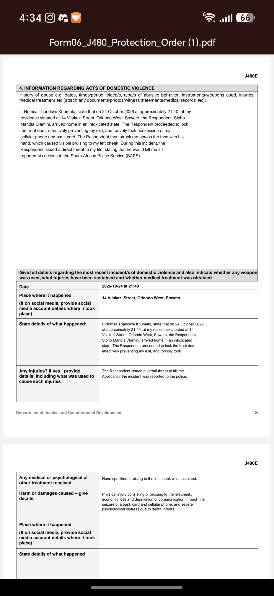
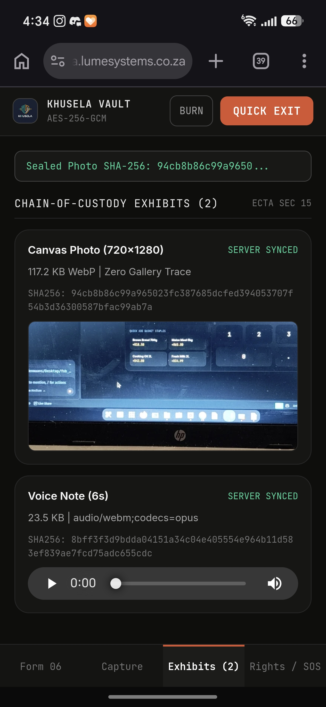
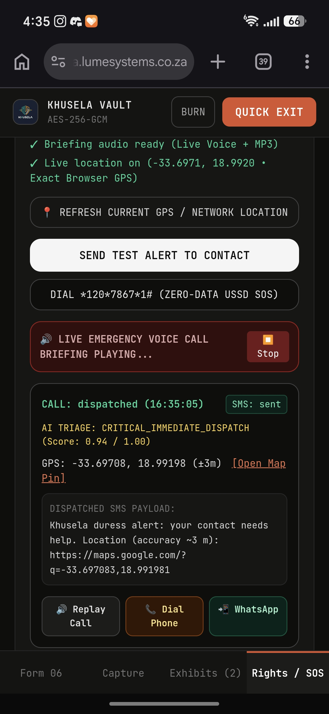
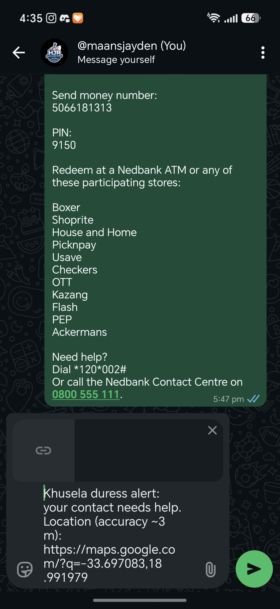
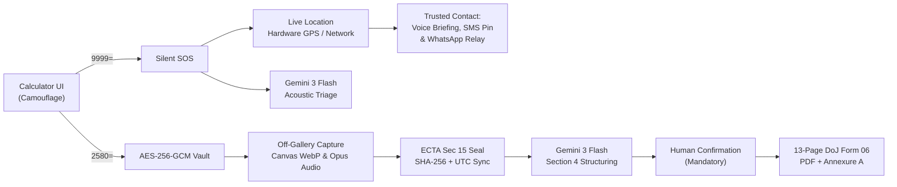

# KHUSELA (SafeLedger)

### *"To Rise Up."* A safety and forensic evidence vault disguised as a grocery calculator.

[-10b981?style=for-the-badge&logo=googledrive&logoColor=white)](https://drive.google.com/file/d/1q1eLHnxAo4Q8hbUDiJslv-z30z_qL0Yo/edit)

[-3b82f6?style=for-the-badge&logo=files&logoColor=white)](docs/Sample_Completed_Form06_J480.pdf)

**FNB App of the Year Hackathon 2026** • Track: **Safer Communities & GBV Response**

*Zero app-store footprint. Zero photo gallery trace. Opens as **Mzansi Smart-Budget** (ZAR & 15% VAT calculator).*

---

## Judge Quick-Access & Submission Hub

Everything assessors need to evaluate **Khusela** is hosted live and mirrored directly in this repository for zero-friction grading:

| Deliverable | Direct Access Link | Judge Notes & Demo Credentials |
|---|---|---|
| **1. Live Hosted Web App (PWA)** | **[https://khusela.lumesystems.co.za](https://khusela.lumesystems.co.za)** | Works on mobile & desktop browsers. No installation or compiling needed. |
| **2. Unlock Encrypted Vault PIN** | Type **`2580`** then press **`=`** | Derives a 256-bit key in volatile RAM (`PBKDF2-SHA256`, 100k iterations) and opens the hidden vault. |
| **3. Silent Duress SOS PIN** | Type **`9999`** then press **`=`** | Fires a silent background SOS while keeping the calculator on screen (`R160.49`). |
| **4. Presentation Deck (PDF)** | **[`docs/Khusela_Presentation_Deck_FNB_2026.pdf`](docs/Khusela_Presentation_Deck_FNB_2026.pdf)** | 10-slide widescreen deck covering Problem, Story, Live Walkthrough, Architecture, SSDLC & Lean Canvas. |
| **5. Demo Video (<90s MP4)** | **[Watch on Google Drive (`edit`)](https://drive.google.com/file/d/1q1eLHnxAo4Q8hbUDiJslv-z30z_qL0Yo/edit)** • **[Direct Stream (`khusela.lumesystems.co.za`)](https://khusela.lumesystems.co.za/static/Khusela_Demo_Video.mp4)** • **[GitHub Raw MP4](https://raw.githubusercontent.com/maansjayden/khusela-safeledger/main/docs/Khusela_Demo_Video.mp4)** | **78.0-second** 1080p narrated mobile screen recording showing the entire user journey end-to-end. |
| **6. Sample Court Output (PDF)** | **[`docs/Sample_Completed_Form06_J480.pdf`](docs/Sample_Completed_Form06_J480.pdf)** | Real 13-page Department of Justice Form 06 (J480) + Form 6A + Annexure A generated by Khusela on mobile. |
| **7. Backup Cloud Mirror** | **[Render Cloud Mirror (`khusela-safeledger.onrender.com`)](https://khusela-safeledger.onrender.com)** | Direct container endpoint backing `khusela.lumesystems.co.za`. |

 
<b>Click the preview above</b> to watch the 78.0s 1080p Demo Video on <a href="https://drive.google.com/file/d/1q1eLHnxAo4Q8hbUDiJslv-z30z_qL0Yo/edit"><b>Google Drive</b></a> (or open the local mirror at <a href="docs/Khusela_Demo_Video.mp4"><code>docs/Khusela_Demo_Video.mp4</code></a>).

---

## The Story: Nomsa's Night in Soweto

> **It is 21:40 on a Thursday in Soweto. Nomsa is in the kitchen. He is in the next room, and he has taken her phone twice this month to read it.**
>
> She cannot call anyone. She cannot be seen typing a message. If she photographs the bruise on her arm, the photo lands in her camera roll, where he will find it.
>
> And even if she survives the night, tomorrow morning she will stand in a queue at the Protea Magistrates Court facing a 12-page legal form in formal English, trying to remember dates, times, and exact words, with nothing she can prove.

Most safety apps are built only for the 10 seconds of panic and forget the weeks before and the morning after. **Khusela covers all three moments.**

| Moment | The Barrier | What Khusela Does |
|---|---|---|
| **1. Before & During Crisis** | She cannot dial `10111` or open a branded "GBV Panic App" without triggering retaliation. | Opens as **Mzansi Smart-Budget**, a working grocery calculator. Typing `9999=` triggers a silent duress alert while the screen stays a calculator. |
| **2. Preserving Proof** | Photos and voice notes saved in a phone gallery are discovered, deleted, or challenged in court. | Captures WebP photos (`<canvas>`) and voice notes directly into an **AES-256-GCM** encrypted IndexedDB vault, sealed with an **ECTA Section 15 SHA-256** hash and UTC timestamp. |
| **3. The Morning at Court** | The 12-page DoJ **Form 06 (J480)** Protection Order affidavit is intimidating under trauma. | **Gemini 3 Flash** structures her raw notes into chronological Section 4 legal prose (with mandatory survivor confirmation) and populates the official **13-page Form 06 + Form 6A + Annexure A PDF** in memory. |

---

## Live Mobile Walkthrough Gallery

All screenshots below were captured live on mobile at **[https://khusela.lumesystems.co.za](https://khusela.lumesystems.co.za)**:

| 1. Calculator Disguise (`2580=` / `9999=`) | 2. Gemini 3 Flash Affidavit Draft | 3. Official 13-Page Form 06 PDF |
|:---:|:---:|:---:|
|  |  |  |
| *Functional ZAR & 15% VAT grocery calculator in plain sight.* | *Raw trauma notes structured into formal Section 4 legal prose.* | *In-memory DoJ Form 06 (J480) + Form 6A + Annexure A.* |

| 4. ECTA Sec 15 SHA-256 Exhibits | 5. Live Voice Call & Exact GPS (`±3m`) | 6. WhatsApp Google Maps Relay |
|:---:|:---:|:---:|
|  |  |  |
| *Off-gallery WebP photo & voice note sealed with SHA-256.* | *Spoken briefing, AI triage (`0.94`) & `±3m` hardware GPS.* | *1-tap WhatsApp relay with clickable Google Maps pin.* |

---

## See It In 90 Seconds (Step-by-Step Judge Walkthrough)

Open **[https://khusela.lumesystems.co.za](https://khusela.lumesystems.co.za)** on your phone or PC browser:

> [!NOTE]
> The first load after inactivity can take ~30–40 seconds while the free Render container wakes up. After that, every interaction is instant.

### Scene 1: The Disguise
You see **Mzansi Smart-Budget**, a rand and 15% VAT grocery calculator. Tap grocery staples (`Brown Bread R18.50`, `Maize Meal R65.00`) or do math. Anyone who inspects the phone sees groceries.

### Scene 2: The Silent Alarm (`9999=`)
Type **`9999`** then **`=`**.
Nothing visible changes on the calculator screen, and that is the point. In the background, Khusela locks her GPS coordinates and prepares the full SOS dispatch for her trusted contact: an alert SMS with a Google Maps pin, a spoken voice briefing, and a WhatsApp message.

> [!IMPORTANT]
> **Demo Note on Carrier Calls & SMS (Twilio Trial):** Real PSTN phone call and SMS delivery uses Twilio. Because our hackathon Twilio trial account has a `USD 0.00` balance and no purchased phone number, Twilio blocks live carrier calls today (see [Honest Limitations & Funding Plan](#honest-limitations-and-the-plan)).
> **How to inspect the alert in the demo:** After typing `9999=`, unlock the vault with **`2580=`** and open the **Rights / SOS** tab. You will see the dispatched alert log, exact GPS coordinates, spoken emergency voice briefing, and a one-tap **WhatsApp** relay button. You can also tap **SEND TEST ALERT TO CONTACT** inside **Rights / SOS** to trigger the full flow on demand.

### Scene 3: The Encrypted Forensic Vault (`2580=`)
Type **`2580`** then **`=`**. The hidden vault unlocks in volatile memory.
- Open **Capture** to record a voice note, take an off-gallery canvas photo, or seal a written note. Nothing ever touches the phone's photo gallery.
- Open **Exhibits** to verify each item's **SHA-256** digest and UTC server timestamp.

### Scene 4: The 13-Page Court Affidavit (`Form 06`)
Open **Form 06**, tap **Load Sample**, tap **Structure Section 4 Statement**, tick the mandatory confirmation checkbox, and tap **Download Official Form 06 (J480) PDF**.
Khusela streams back the official 13-page Department of Justice **Form 06 (J480)** with every section populated plus **Annexure A** listing her SHA-256 evidence hashes.

### Scene 5: Her Rights in 4 South African Languages
Open **Rights / SOS** and play her legal rights under the Domestic Violence Act (Form 08 / J506) in **English, Afrikaans, isiXhosa, or isiZulu**.

### Scene 6: The `<16ms` Escape Hatch
Tap **QUICK EXIT**, press **Volume Down**, press `Escape`, or shake the phone: volatile memory is cleared and the screen snaps back to the calculator in under 16 milliseconds. Entering a wrong 4-digit PIN 3 times automatically purges the encrypted IndexedDB vault.

---

## System Architecture

### Core Engineering Principles
1. **Call-First, Enrich-Second:** Emergency dispatch fires before AI triage runs. AI runs asynchronously in the background and never blocks life-safety alerts.
2. **Human-in-the-Loop Legal AI:** Gemini 3 Flash structures only what the survivor wrote without inventing facts, and PDF export is locked until the survivor ticks the accuracy confirmation.
3. **Hard-Coded Emergency Number Blocklist:** `/api/v1/sos/trigger` enforces a strict guard preventing automated test calls to `10111`, `10177`, `112`, `911`, or `0800428428`.
4. **Zero Server-Side PII Storage:** Decryption keys exist only in browser RAM, raw media stays on-device, and the Form 06 PDF is generated in memory (`io.BytesIO`) with `Cache-Control: no-store`.

---

## Honest Limitations (and the Plan)

### Carrier Calls and SMS (Twilio Trial)
The SOS engine is wired for live carrier voice calls and SMS via Twilio. For the hackathon we run on a **Twilio trial account with a USD 0.00 balance and no purchased South African phone number**, so Twilio blocks the live PSTN carrier leg. **This is a funding limit, not a code limit:** upgrading the Twilio account and setting `TWILIO_FROM_NUMBER` activates live carrier calls and SMS immediately with zero code changes.

To make every feature testable at zero cost today, Khusela automatically fails over to our **WebRTC Voice Briefing + SMS Preview + 1-Tap WhatsApp Relay**:

| Channel | Live Demo Today (R0 Cost) | With Funded Twilio (~R1,000) |
|---|---|---|
| **Voice Call** | Spoken South African English emergency briefing + 1-tap `📞 Dial Phone` button | Automated outbound carrier phone call reading the briefing via TwiML |
| **SMS** | Full SMS payload with clickable Google Maps pin generated and displayed | Delivered directly via carrier SMS to the trusted contact |
| **WhatsApp** | 1-tap pre-filled WhatsApp alert with exact GPS Google Maps link | Same + automated WhatsApp Business API template |
| **Location** | Browser hardware GPS (`±3m`) with live South African ISP network fallback | Same + cell-tower triangulation |
| **Zero-Data** | Simulated `*120*7867*1#` USSD gateway inside the vault | Live USSD shortcode via South African aggregator |

### 7-Phase Funding Roadmap to 100% Production

| Phase | Milestone | Outcome | Est. Cost |
|---|---|---|---|
| **1. Week 1** | Upgrade Twilio account & provision SA voice/SMS number (`TWILIO_FROM_NUMBER`) | Live `9999=` carrier calls & SMS with zero code changes | ~R1,000 setup (~R0.50–R2/alert) |
| **2. Week 1–2** | Always-on Render production instance + 24/7 uptime monitoring | Zero cold-start delay; instant response 24/7 | ~R350 / month |
| **3. Month 1** | Multi-contact escalation tree & delivery receipts inside the vault | Automatic rollover if primary contact does not answer | Engineering time |
| **4. Month 1–2** | Live USSD (`*120*7867#`) shortcode & zero-data SMS gateway | Works on any feature phone with R0 airtime/data | Aggregator quote |
| **5. Month 2–3** | Private security & community patrol control-room webhook integration | Armed response dispatch alongside trusted contact alert | Partnership-based |
| **6. Month 2–3** | Optional native Android wrapper for background hardware-button triggers | Discreet pocket trigger without waking screen | ~R400 Play Store fee |
| **7. Ongoing** | Independent POPIA, cryptographic & GBV NGO field audit | Court & social-worker rollouts nationwide | Grant / CSR funded |

---

## Tech Stack & Documentation

| Layer | Technology |
|---|---|
| **Frontend PWA** | React 18, Vite, Tailwind CSS, Lucide Icons, Service Worker |
| **Client Cryptography** | Web Crypto API: `PBKDF2-SHA256` (100,000 iterations), `AES-256-GCM`, `SHA-256` |
| **Backend API** | Python 3.10+, FastAPI, Uvicorn, Pydantic v2, `httpx` |
| **AI Engine** | Google Gemini (`gemini-3-flash-preview`) via `google-genai` SDK with offline fallback |
| **Court PDF Engine** | `pypdf` + ReportLab in-memory (`io.BytesIO`) coordinate overlay on official DoJ Form 06 (J480) |
| **Telephony & Geo** | Twilio Programmable Voice & SMS + WebRTC Voice Proxy + HTML5 Geolocation / SA IP Geo |
| **Deployment** | Docker multi-stage build on Render (`https://khusela.lumesystems.co.za`) |

- **Developer Setup, API Tests & Docker Guide:** [`docs/DEVELOPMENT.md`](docs/DEVELOPMENT.md)
- **Full Lean Business Canvas & SSDLC Submission Document:** [`docs/SONKE_SUBMISSIONS_AND_CHECKLIST.md`](docs/SONKE_SUBMISSIONS_AND_CHECKLIST.md)

---

**Khusela (SafeLedger)** — *Because the safest app is the one nobody knows is there.*

**[Launch Live App](https://khusela.lumesystems.co.za)** • **[Watch Demo Video (Google Drive)](https://drive.google.com/file/d/1q1eLHnxAo4Q8hbUDiJslv-z30z_qL0Yo/edit)** • **[View Presentation Deck (PDF)](docs/Khusela_Presentation_Deck_FNB_2026.pdf)**

