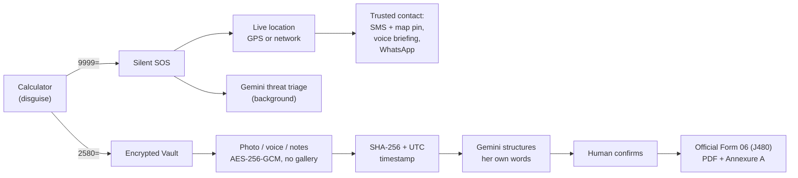

<div align="center">

# Khusela

### *"To rise up."* A safety and evidence app that looks like a calculator.

**FNB App of the Year Hackathon 2026** | Track: **Safer Communities & GBV Response**

**[Open the live app: khusela.lumesystems.co.za](https://khusela.lumesystems.co.za)**

*Install it from the browser. No app store. No trace in the gallery. It opens as a grocery calculator.*

</div>

---

## The Story

> **It is 21:40 on a Thursday in Soweto. Nomsa is in the kitchen. He is in the next room, and he has taken her phone twice this month to read it.**
>
> She cannot call anyone. She cannot be seen to type a message. If she photographs the bruise on her arm, the photo lands in her gallery, where he will find it.
>
> And even if she survives the night, the next morning she will stand in a queue at the Magistrate's Court with a 12-page form, trying to remember dates, times and exact words, with nothing she can prove.

Most safety apps are built for the moment of danger and forget the weeks before and after it. Khusela covers **all three moments**.

| Moment | The problem | What Khusela does |
|---|---|---|
| **1. The danger** | She cannot call or message without being seen | Type `9999` then `=` on a calculator. The screen stays a calculator. Her trusted contact is alerted with a live map pin. |
| **2. The proof** | Photos and notes in a gallery are found, deleted, or dismissed in court | Evidence goes straight into an encrypted vault, never the gallery, each item sealed with a SHA-256 fingerprint and a server timestamp. |
| **3. The court** | The Protection Order form is long, legal and intimidating | She types what happened in her own words. Khusela structures it into the official **Form 06 (J480)** and gives her a court-ready PDF. |

---

## See It In 90 Seconds

**Open https://khusela.lumesystems.co.za on your phone** and follow Nomsa's night.

> The first load can take up to about 40 seconds because we run on a free hosting tier. After that it is instant.

### Scene 1: The disguise
You see **Mzansi Smart-Budget**, a rand and 15% VAT grocery calculator. It works. Anyone who picks up the phone sees groceries.

### Scene 2: The silent alarm
Type **`9999`** then **`=`**.
Nothing visible happens, and that is the point. Behind the screen, Khusela takes her location and sends the SOS to her trusted contact: an alert SMS with a Google Maps pin, a spoken briefing, and a one-tap WhatsApp message.
It never dials `10111`, `112` or any emergency line (a hard-coded safety lock), and it never makes up a location if GPS is missing.

### Scene 3: The vault
Type **`2580`** then **`=`**. The vault opens.
- **Capture** a photo, a voice note, or a written note. Nothing touches the gallery.
- Open **Exhibits** to see each item with its SHA-256 fingerprint and timestamp.
- Everything is encrypted on the device with **AES-256-GCM**, using a key derived from her PIN (PBKDF2, 100,000 iterations).

### Scene 4: The paperwork
Open **Form 06**, press **Load Sample**, then **Structure Statement**, tick the confirmation, and press **Download**.
You get the official Department of Justice **Form 06 (J480)**, every page filled in, plus an **Annexure A** listing her evidence fingerprints.

### Scene 5: The escape hatch
Press **Quick Exit**, the **Volume Down** key, or shake the phone: it is a calculator again in under 16 ms. Press **Burn**, or enter a wrong PIN 3 times, and the local vault is wiped.

### Scene 6: Her rights, in her language
Open **Rights / SOS** and play her rights under the Domestic Violence Act in **English, Afrikaans, isiXhosa or isiZulu**.

---

## How It Works



**Principles we hold to**
1. **Alert first, analyse second.** The contact is called and texted before any AI runs. AI work happens in the background and never delays help.
2. **A human always confirms.** Gemini only structures what the survivor wrote. It must not invent facts, and nothing is exported without her confirmation.
3. **Honest failure.** If a message cannot be delivered, the app says so. It never shows fake success.
4. **No server-side evidence storage.** The PDF is generated in memory and sent with `Cache-Control: no-store`.

---

## Why Khusela Stands Out

| Typical safety app | Khusela |
|---|---|
| Looks like a safety app, so it is a risk if found | Looks and works like a calculator |
| Panic button only | Panic button, evidence vault and legal paperwork in one flow |
| Needs an app store download | Installs from the browser, nothing to find in an app list |
| Photos saved to the gallery | Off-gallery capture into an encrypted vault |
| Evidence is hard to defend in court | SHA-256 fingerprints and server timestamps support chain of custody (ECTA section 15) |
| Legal forms in legal English | Her own words become the official Form 06 |
| English only | Rights audio in 4 South African languages |

---

## Honest Limitations (and the plan)

### Carrier calls and SMS (Twilio)
The SOS is built for a real carrier voice call and SMS through Twilio. For the hackathon we run on a **Twilio trial with a USD 0.00 balance and no purchased number**, so Twilio blocks the carrier leg itself. This is a **funding limit, not a design or code limit**.

To keep the demo fully working at zero cost, the server **fails over automatically** when the carrier is unavailable:

| Channel | Demo today (free) | With funding |
|---|---|---|
| Voice call | Spoken emergency briefing on screen, plus a one-tap native dialer button | Automated Twilio call with the recorded briefing |
| SMS | Full alert text with Google Maps pin generated and shown | Delivered by SMS to the trusted contact |
| WhatsApp | One-tap pre-filled message | Same, or WhatsApp Business API |
| Location | Device GPS, or live network location when GPS is unavailable | Same, plus carrier cell-tower location |
| Zero-data | USSD flow simulated in the app | Real USSD shortcode through an aggregator |

When the free relay is used, the response says so (`delivery_channel: webrtc_voice_proxy`). The tests also check that, without the fallback flag, a failed delivery is reported as a failure.

### Funding plan: taking it to 100%
Every phase plugs into what already exists. Funding switches on the paid carrier leg and adds reach and reliability. It does not need a rebuild. Costs are rough estimates, to be confirmed with quotes.

| Phase | Work | Outcome | Est. cost |
|---|---|---|---|
| **1. Week 1** | Upgrade Twilio, buy a South African capable number, set `TWILIO_FROM_NUMBER` | Real call and SMS, no code changes | About R1 000 setup, then roughly R0.50 to R2 per alert |
| **2. Week 1 to 2** | Always-on hosting, error monitoring, uptime alerts | Reliable 24/7 service | About R150 to R400 per month |
| **3. Month 1** | Several trusted contacts, escalation order, delivery receipts in the vault | Alert still lands if the first contact is unreachable | Build time |
| **4. Month 1 to 2** | Real USSD shortcode and an SMS-only trigger | Works on feature phones and with no data | Aggregator fees, to be quoted |
| **5. Month 2 to 3** | Partnerships with private security and community patrols | An alert becomes a response | Partnership based |
| **6. Month 2 to 3** | Native Android wrapper for hardware button triggers and background GPS | Faster, more discreet trigger | R400 once-off |
| **7. Ongoing** | Independent security review, POPIA review, testing with GBV support organisations | Trust for wide rollout | To be quoted |

---

## Tech Stack

| Layer | Choice |
|---|---|
| Front end | React 18, Vite, Tailwind, installable PWA |
| Crypto | Web Crypto API: PBKDF2-SHA256 (100k) and AES-256-GCM, SHA-256 hashing |
| Back end | Python, FastAPI, Uvicorn |
| AI | Google Gemini via `google-genai` (legal structuring and threat triage) |
| PDF | `pypdf` and ReportLab overlay on the official DoJ Form 06 template |
| Messaging | Twilio (voice and SMS) with a free relay fallback |
| Hosting | Docker on Render, custom domain on HTTPS |

---

## Run It Yourself

### Environment (`backend/.env`)
Copy `backend/.env.example` to `backend/.env` and set:

```ini
GEMINI_API_KEY=your_gemini_api_key_here
TWILIO_ACCOUNT_SID=ACxxxxxxxxxxxxxxxxxxxxxxxxxxxxxxxx
TWILIO_AUTH_TOKEN=your_twilio_auth_token_here
TWILIO_API_KEY_SID=SKxxxxxxxxxxxxxxxxxxxxxxxxxxxxxxxx
TWILIO_API_KEY_SECRET=your_twilio_api_key_secret_here
TWILIO_FROM_NUMBER=+15005550006
TRUSTED_CONTACT_NUMBER=+27820000000
BASE_URL=https://your-public-host.example
```

- `TRUSTED_CONTACT_NUMBER`: the single trusted number that receives the SOS.
- `TWILIO_FROM_NUMBER`: a voice and SMS capable Twilio number. On a trial account, sender and recipient must be verified.
- `BASE_URL`: public HTTPS origin, inferred from `X-Forwarded-Proto` and `Host` behind a proxy.
- Without Gemini or Twilio keys the app still runs, using its built-in fallbacks.

### Backend (`http://localhost:8000`)
```bash
cd backend
python3 -m venv .venv
source .venv/bin/activate
pip install -r requirements.txt
cp .env.example .env
uvicorn main:app --reload --host 0.0.0.0 --port 8000
```

### Frontend (`http://localhost:5173`)
```bash
cd frontend
npm install
npm run dev
```
Build the production PWA that FastAPI serves on port 8000:
```bash
cd frontend
npm run build
```

### Tests
```bash
backend/.venv/bin/python backend/test_api.py
```
Covers the emergency-number safety lock, honest failure reporting, SMS and voice content, evidence hash integrity, Form 06 PDF generation, and a path traversal guard.

### Docker
```bash
docker build -t khusela .
docker run -p 8000:8000 --env-file backend/.env khusela
```

---

<div align="center">

**Khusela: because the safest app is the one nobody knows is there.**

</div>
